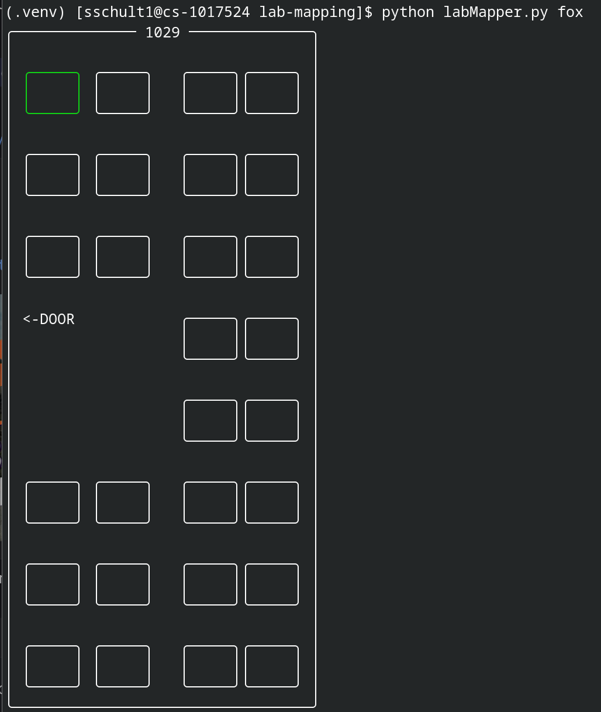

Generates a map to an asset in the BYU animation labs. Must be run in a python virtual environment if packages in requirements.txt are not system wide.

To get up and running quickly, clone the repo and create a python virtual environment at the repo root.
Run `pip install -r requirements.txt` to install everything the program needs to run.
